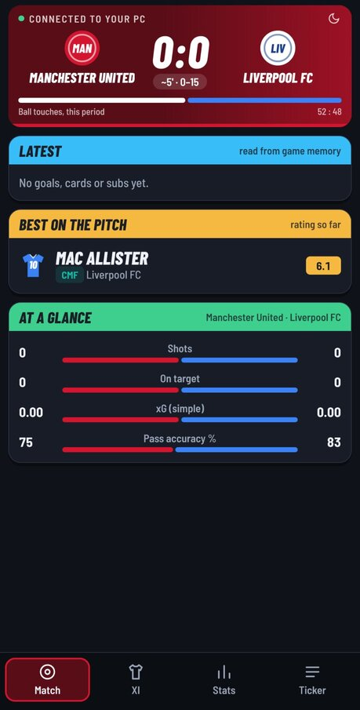
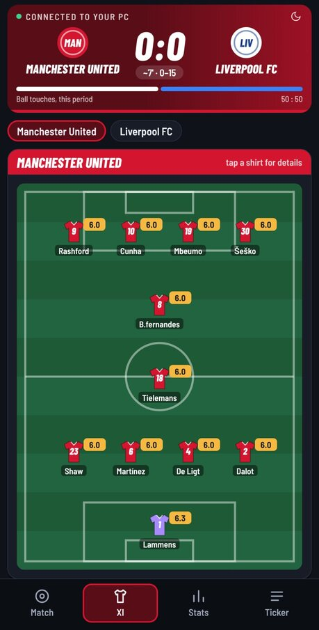
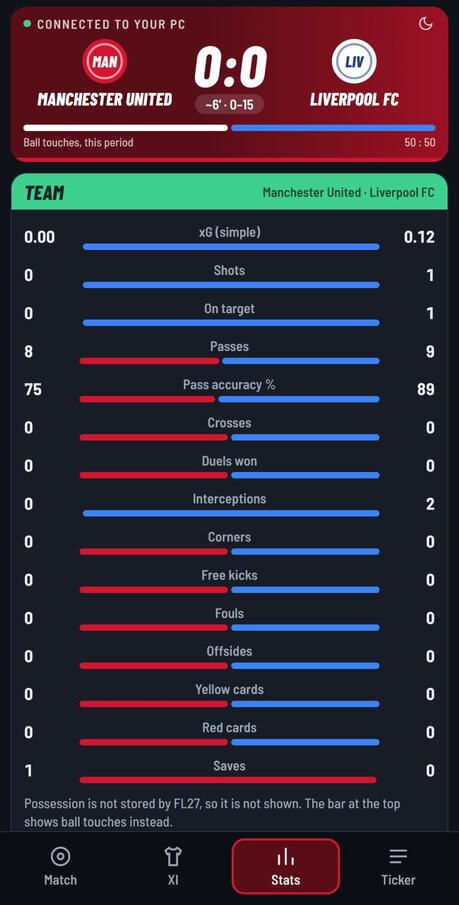

# PESM Coaching Zone

**Live match stats from Football Life 2027 on your phone, over your home Wi-Fi.**

You play FL27 full screen on your PC. Your phone sits next to you and shows the match as it happens:

<p align="center">
  
  
  
</p>

- **Match:** score, scorers, the latest goals, cards and substitutions, best player so far
- **XI:** the eleven players actually on the pitch, with live ratings. Tap a shirt for the player's stats. Bench and subs are included.
- **Substitutions from the phone:** tap one of your players, pick one of three suggested bench players (or look at the whole bench), confirm. FL27 makes the change at the next stoppage, just like a sub from the pause menu.
- **Stats:** shots, xG, passes, pass accuracy, duels, corners, fouls, cards and saves, plus the flow per 15 minutes and a player table
- **Ticker:** goals (incl. penalties and free kicks), missed penalties, big chances, cards and substitutions. Switch to "Everything" to also see corners, free kicks, offsides and shots wide.
- **Vibration** when a goal, a card or a missed penalty happens
- Light and dark theme

It runs in the phone's browser, so you don't install an app. Nothing goes to the internet: the PC and the phone talk only inside your home network.

> Unofficial fan tool. Not affiliated with or endorsed by Konami or the Football Life team. It reads the game's memory while you play. The only thing it ever writes is a substitution you ask for on the phone (turn that off with `--no-subs`). It never changes the game's files or your saves.

## Quick start

1. Download the program for your system from [Releases](../../releases):
   - Windows: `pesm-coaching-zone-windows-x86_64.exe`
   - Linux: `pesm-coaching-zone-linux-x86_64`
2. Start it. A page opens on your PC with a QR code.
3. Scan the QR code with your phone. The phone must be on the same Wi-Fi.
4. Start FL27 and a match. The stats appear on your phone.

Want to try it without the game? Run it with `--demo`.

### Player names

The game's memory only holds player ids. To show names, shirt numbers and positions, tell the program where your game is once:

```
pesm-coaching-zone --game "C:\Games\Football Life 2027"
```

It reads `sider.ini` there (or in `SiderAddons/`) and uses the database of the first mod in the `cpk.root` list that has one (`…/common/etc/pesdb/Player.bin`). You can also point at that folder directly with `--pesdb <folder>`. The choice is remembered.

### Linux (Wine/Proton/Lutris)

Linux only lets a program read (and, for substitutions, write) another program's memory if you allow it. Do this once, and again after each update of the file:

```
sudo setcap cap_sys_ptrace+ep ./pesm-coaching-zone-linux-x86_64
```

Or, until the next reboot only: `sudo sysctl kernel.yama.ptrace_scope=0`

### Windows

Windows may ask whether the program may use the network. Allow **private networks**, otherwise your phone can't connect.

Substitutions from the phone need the same rights as the game. If the PC window says "Substitutions from the phone are off" although you didn't turn them off, start PESM Coaching Zone as the same user as the game (or as administrator).

## Options

```
--game <folder>    FL27 game folder (with sider.ini). Used to find player names.
--pesdb <folder>   pesdb folder with Player.bin, if you want to pick it yourself.
--port <number>    Port for the phone page (default 8317).
--demo             Play a made-up match, no game needed.
--no-browser       Don't open the PC page in the browser.
--no-subs          Read only: don't allow substitutions from the phone.
```

## What it can and can't know

FL27 keeps a statistics record per player and per 15-minute period in memory. PESM Coaching Zone reads it every 2 seconds.

- **Confirmed in real matches:** goals (incl. free kicks and penalties), own goals, assists, shots, shots on target, passes (short, through, long), crosses, duels won, interceptions, fouls, offsides, yellow and red cards, free kicks, corners, touches, saves.
- **The minute is an estimate.** The game clock is not stored in a readable way. The program knows the 15-minute period and estimates the minute inside it from how long periods take on your PC.
- **Possession is not stored.** The bar under the score shows the share of ball touches in the current period instead.
- **Line-ups and substitutions** come from the game's live line-up and its substitution queue, so the XI tab shows exactly who is on the pitch. If that part of memory can't be found, the program falls back to guessing: a sub is detected when a bench player starts playing, and the player who went off is the one who stopped running.
- **How a sub from the phone works:** the program puts the change into FL27's own substitution queue, the same place the pause menu uses. FL27 checks and carries it out at the next stoppage. The program refuses players who aren't on the pitch or on the bench, and stops when no substitutions are left.
- **Big chances** are shots on target that the keeper saved. A missed penalty is a penalty shot without a goal.
- **Ratings** are a simple formula, not the game's own rating.
- **Supported game version:** `FL_2027.exe` 1.00. A game update can move things in memory. If the stats stop showing up, please open an issue.

## Pairing and safety

- The server listens on your home network only while the program runs.
- A phone needs the secret from the QR code, or the 4-digit code shown on the PC. Five wrong codes lock pairing for 30 seconds.
- The PC page with the QR code only opens on the PC itself.
- Paired phones stay paired. Delete the config file to un-pair all phones: `%APPDATA%\pesm-coaching-zone\config.json` on Windows, `~/.config/pesm-coaching-zone/config.json` on Linux.

## Build from source

```
cargo build --release
cargo test
```

The reading code is a library (`process`, `stats`, `lineup`, `pesdb`, `live`) that other tools can use.

## Credits

- Part of the PES M project.
- Fonts: [Barlow](https://github.com/jpt/barlow) by Jeremy Tribby, SIL Open Font License 1.1 (`web/fonts/OFL.txt`).

## License

MIT, see [LICENSE](LICENSE).
